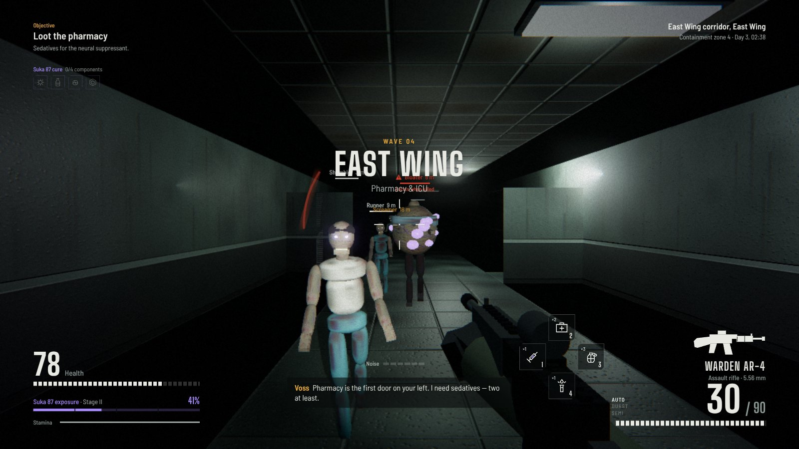
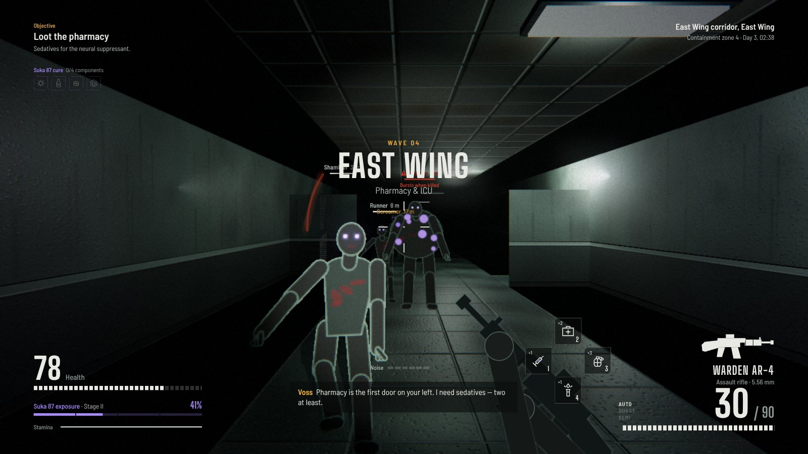
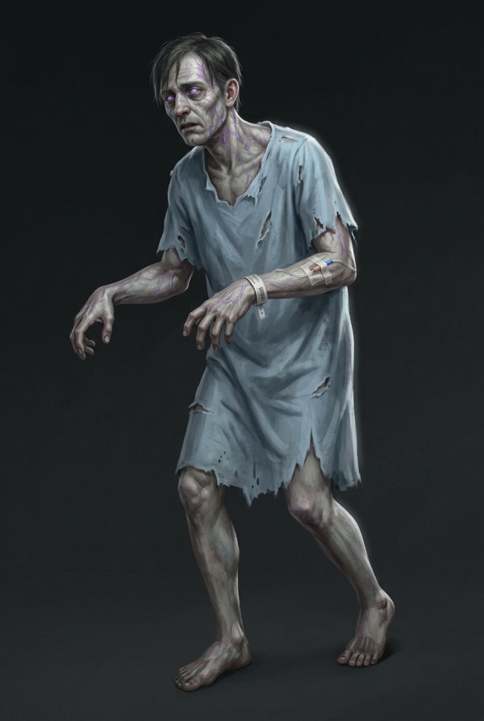
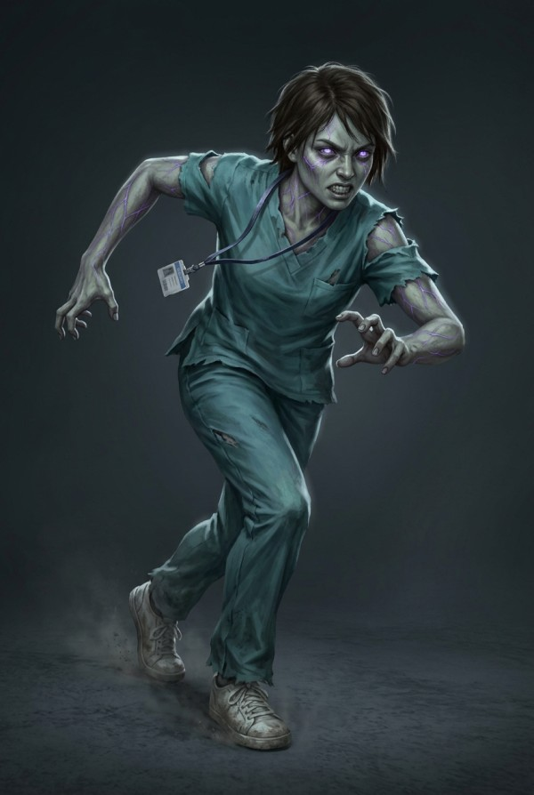
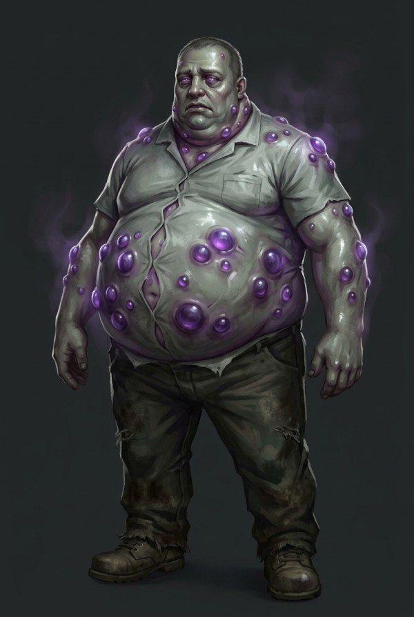
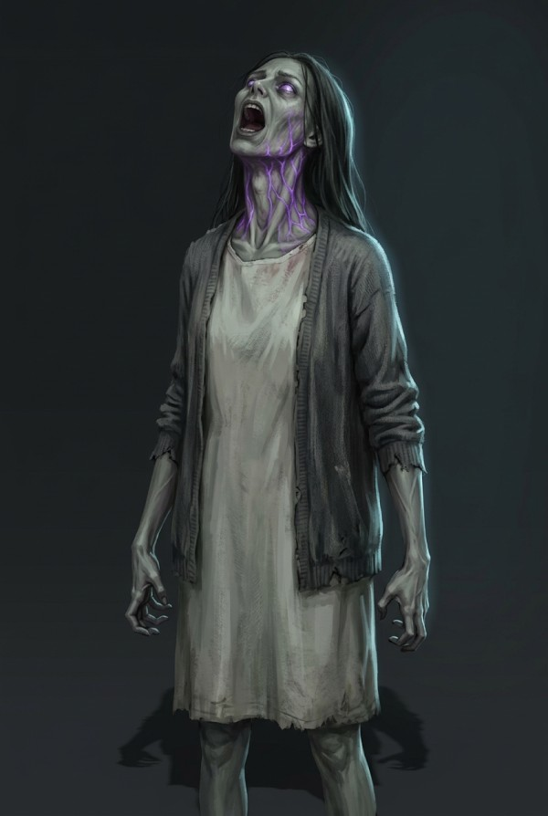
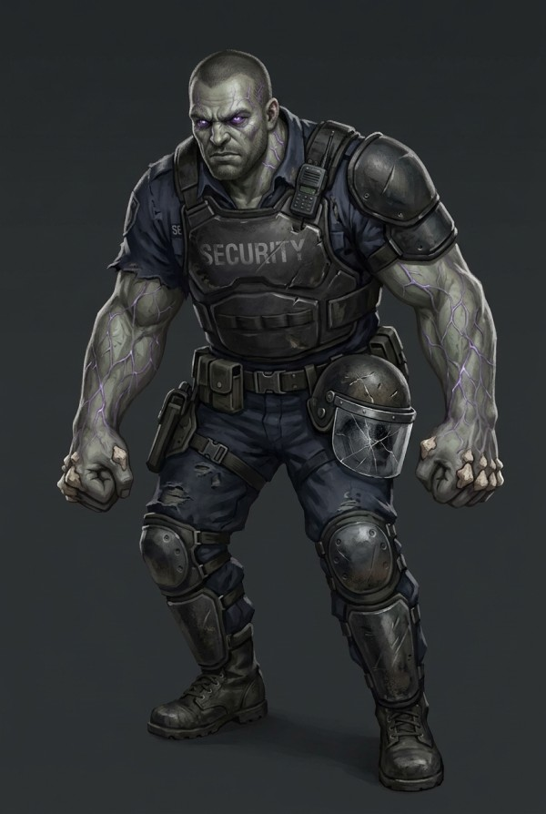
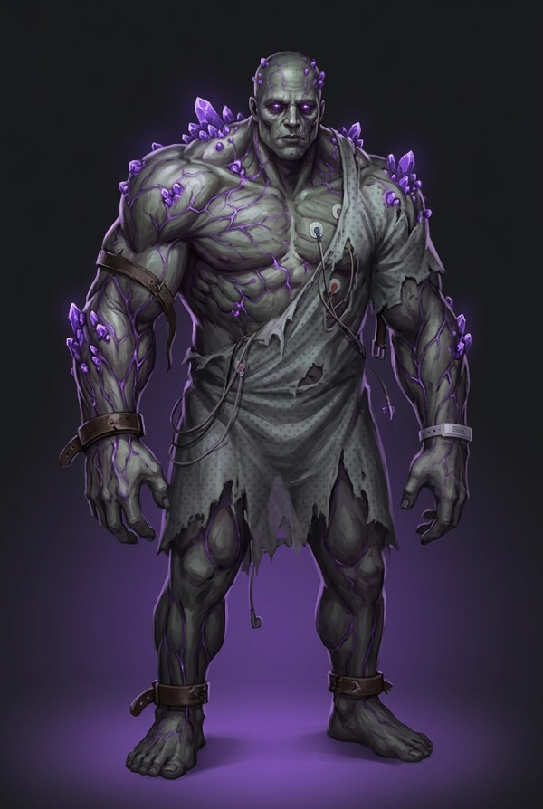
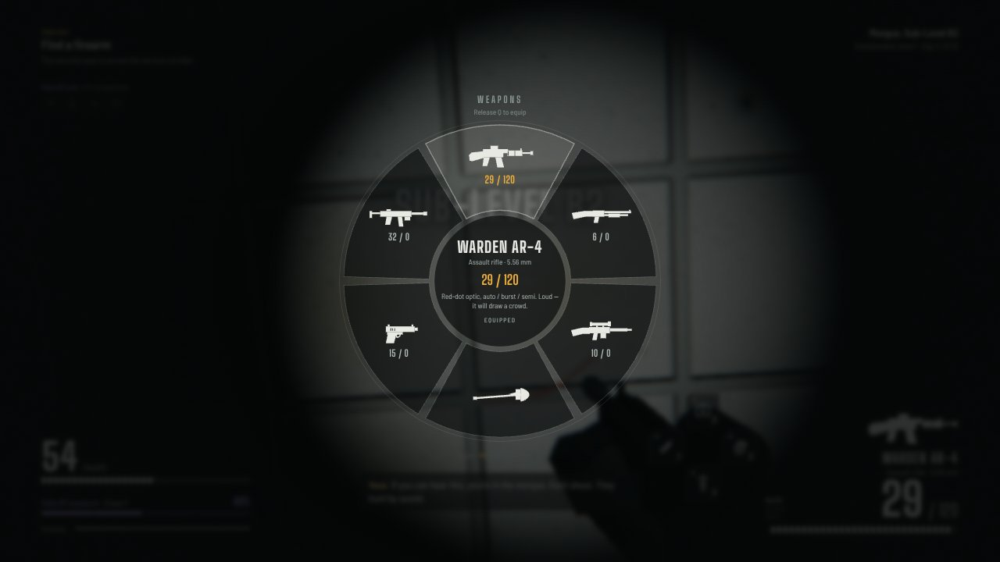
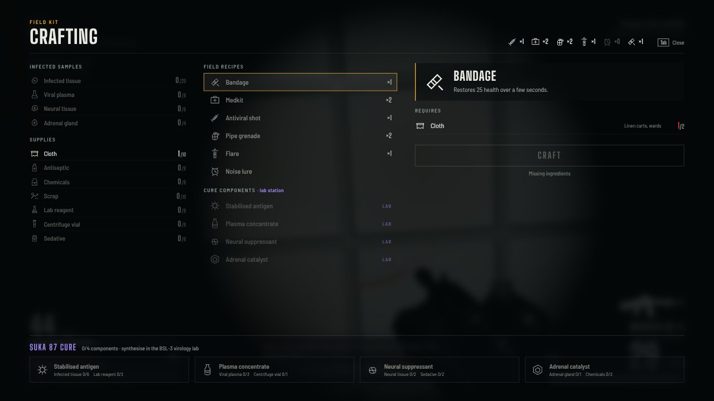

# Suka 87

A first-person survival shooter set in St. Brendan's Hospital on day three of the Suka 87 outbreak.
Fight up from the morgue in sub-level B2 to the virology lab in the research wing, harvest what the
infected carry, and synthesise the cure.



Built for the browser with TypeScript and Three.js. Every texture, model and sound is generated
procedurally at load time, so the repository has no binary art or audio assets. The HUD follows the
supplied *Gameplay HUD* design (1920×1080 spec, Barlow Semi Condensed + Big Shoulders Display).

## Running it

```bash
npm install
npm run dev          # http://localhost:5173
npm run build        # type-check + production bundle in dist/
npm run preview      # serve the production build
npm run validate:levels   # connectivity / door / placement checks for every map
```

Use a desktop browser with a mouse; the game captures the pointer when you click the view.
Headphones are recommended because enemy positions are audible (HRTF spatial audio).

## 2D sprite mode

By default the infected, pickups and the held weapon are drawn as 2D sprites (Doom-style
billboards) inside the 3D hospital, so gameplay can be tested before 3D models exist. Drop your
PNGs into `public/sprites/` and list them in `public/sprites/sprites.json`; see
[`public/sprites/README.md`](public/sprites/README.md) for sheet layout and naming. Anything not
listed uses a generated placeholder. The six infected currently use the concept paintings from
`docs/concepts/`, cut out to transparent PNGs in `public/sprites/infected/`; single-image sprites
get procedural bob, sway, lunge and a fall-over death. Toggle **Settings → Display → 2D sprite characters** to switch
back to the procedural 3D models at any time; hit zones and AI are identical in both modes.



## How it plays

**Waves are levels.** Each wave is a section of the hospital with its own objectives. Every wave
the strain adapts: infected get +20% durability, +14% damage, +5.5% speed and more aggression,
sight range and numbers. The briefing screen shows the exact adaptation before each wave.

| Wave | Area | Objectives | New threat |
|---|---|---|---|
| 1 | Sub-Level B2 — Morgue & Plant | Find a firearm · restore power · reach the service elevator | Shambler, Runner |
| 2 | Sub-Level B1 — Maintenance & Linen | Get the facilities keycard · unlock Stairwell A | Bloater |
| 3 | Ground Floor — Emergency Department | Override the ER lockdown · reach the East Wing | Screamer |
| 4 | East Wing — Pharmacy & ICU | Loot sedatives · kill Patient Zero · cross the skybridge | Brute, Patient Zero |
| 5 | Research Wing — Virology BSL-3 | Cycle the airlock · prepare the four components · synthesise and hold for 90 s | — |

**The cure** is built from four components, each cultured at a lab station:

| Component | Ingredients | Where they come from |
|---|---|---|
| Stabilised antigen | 6 infected tissue + 2 lab reagent | Any infected · labs, radiology |
| Plasma concentrate | 3 viral plasma + 1 centrifuge vial | Bloaters · labs |
| Neural suppressant | 2 neural tissue + 2 sedatives | Screamers · pharmacy |
| Adrenal catalyst | 1 adrenal gland + 2 chemicals | Brutes / Patient Zero · maintenance |

Kill an infected, then hold **E** on the body to harvest it. From wave 4 the spawn director biases
towards whichever infected type still carries something the cure needs, so a run can't soft-lock.

**Suka 87 exposure** rises with every wound and inside Bloater mist. Stage I–IV are shown on the
HUD; past stage II it keeps climbing on its own, stage III shakes your aim and drains stamina,
stage IV drains health, and 100% means you turn. Antiviral shots knock it back by 35%.

**Noise matters.** Gunfire, sprinting, doors and the generator all broadcast an alert radius.
Crouching roughly halves how far you can be seen; shining your flashlight at an infected extends it by a third. Flares
and noise lures pull infected away.

### Infected

| Type | Behaviour |
|---|---|
| Shambler | Slow, limping, arms reaching. Hunts by sound. |
| Runner | Fast, fragile, lunges over the last few metres. |
| Bloater | Tanky. Ruptures into a viral mist on death — exposure and damage inside it. Drops plasma. |
| Screamer | Keeps its distance; its scream alerts everything within 40 m and calls a pack. Drops neural tissue. |
| Brute | Armoured (body hits ×0.55). Charges in a straight line; if it hits a wall it's stunned and takes ×1.5 damage. Drops adrenal glands. |
| Patient Zero | Wave 4 boss: an oversized Brute dormant in ICU isolation. |

Infected bash through closed doors, path around props with a flow field, separate from each other,
and react to hits with stagger, head-snaps and limp falls. Lethal head hits on smaller infected
take the head off.

#### Concept art

Reference designs for each infected type (full sheet with stats, harvest and design notes:
[`docs/concepts/infected-roster.jpg`](docs/concepts/infected-roster.jpg)). They are meant as the
target look for the 2D sprite sheets and, later, the 3D models.

| Shambler | Runner | Bloater |
|---|---|---|
|  |  |  |
| **Screamer** | **Brute** | **Patient Zero** |
|  |  |  |

### Weapons and tools

| Weapon | Notes |
|---|---|
| Fire axe | Starting weapon. Silent, heavy stagger. |
| Kestrel P9 | 9 mm service pistol. |
| Courier SMG-9 | 9 mm, auto/semi. |
| Warden AR-4 | 5.56 mm, red-dot, auto/burst/semi. |
| Harrow SG-12 | 12 ga pump, shell-by-shell reload (fire to interrupt). |
| Lancet DMR-7 | 7.62 mm, scoped, over-penetrates one target. |

Tools: bandage, medkit, antiviral shot, pipe grenade, flare, noise lure. All are craftable in the
field kit (**Tab**) from scavenged cloth, antiseptic, chemicals and scrap.

| Weapon wheel | Field kit |
|---|---|
|  |  |

## Controls

| Key | Action |
|---|---|
| W A S D · Shift · C/Ctrl · Space | Move · sprint · crouch · jump |
| Mouse 1 · Mouse 2 | Fire/swing · aim down sights |
| R · B · V | Reload · fire mode · quick melee |
| Q (hold) / tap | Weapon wheel / swap to last weapon |
| T (hold) | Tool wheel |
| 1 – 4 | Antiviral · medkit · pipe grenade · flare |
| E (tap or hold) | Interact, harvest, open doors |
| Tab | Field kit (crafting); at a lab station it opens culture & synthesis |
| F | Flashlight |
| Esc | Pause |

Game time slows to 20% while a wheel is open and 35% in the field kit.

## Project layout

```
src/
  core/       renderer + post-processing, input, procedural audio engine, settings, math
  data/       weapons, items & recipes, infected types & wave scaling, the five levels
  world/      map builder, level runtime (geometry, collision, LOS, flow-field nav, lights),
              procedural textures, materials, props
  game/       game loop & state, player, weapons + viewmodels, infected AI + rigs, director,
              objectives, interactions, tools/throwables, effects
  ui/         HUD, radial wheels, crafting panel, menus, icon sprite
  styles/     HUD and menu styles
scripts/      level validator
docs/         screenshots and the original HUD design (docs/design/gameplay-hud.html)
```

Levels are authored in `src/data/levels.ts` with a small builder (`room`, `door`, `put`, `weapon`,
`key`, `terminal`). One character is one 2 m tile; the legend is documented at the top of
`src/world/mapbuilder.ts`. Run `npm run validate:levels` after editing a map.

Progress is checkpointed at the start of every wave (local storage). Settings cover sensitivity,
FOV, render scale, shadows, bloom, grain, enemy labels, volumes and three difficulties.

## Production notes

Everything visual and audible is procedural so the game is complete and self-contained today. The
code is structured so real assets can replace the generated ones without touching gameplay:

- **Characters** — `buildRig` in `src/game/infected.ts` returns named joints and hit meshes. A
  skinned glTF with the same joint names (plus an animation mixer) can drop in.
- **Weapons** — `buildViewModel` in `src/game/viewmodels.ts` returns `muzzle`, `mag`, `slide` and
  `pump` handles that the animation code drives.
- **Audio** — every sound goes through `AudioEngine` in `src/core/audio.ts`; swap individual
  methods for sample playback.
- **Textures** — `src/world/textures.ts` returns `{ map, normal }` pairs per surface style.
